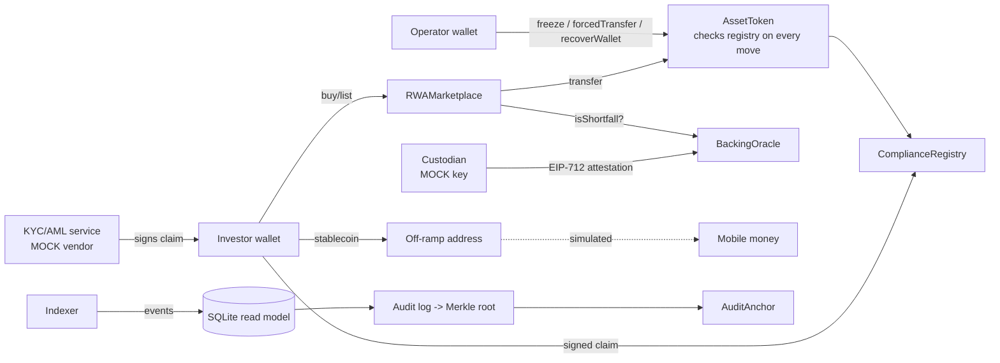

# Tessera × Node Engine Hackathon 2026 - Real-World Assets track

How this project maps to the track brief, the MVP checklist and the judging rubric - including what is **built**, what is **mocked**, and what is **missing**. Written to be read by a judge in five minutes.

## Problem statement (workshop format)

> For **a salaried South African who has R500–R50 000 to invest** *(illustrative persona - replace with a real named user, see TODO)*, buying a slice of commercial property or a solar farm is closed off today because tickets start in the millions, income arrives through intermediaries, and selling can take months. We will demonstrate a **KYC-gated purchase of fractional shares in a tokenised office tower** *(mock asset)*, automatic rental yield, and **cash-out to a mobile-money wallet** using a custodian-attested, compliance-enforcing share token.

> **TODO (team) - needed for the Business score:** the rubric rewards "a named African user and asset owner". Replace the persona and the sample assets with a real person/organisation you have spoken to, and name the licence or regulated partner you would use (see the partner column below). Nothing in the repo invents one for you.

## MVP checklist

| Track requirement | Where it lives | Status |
|---|---|---|
| 1. Token for one specific asset, on a public testnet | `AssetFactory` → one `AssetToken` (ERC-20, 0 decimals) per asset; EVM, deploy to any testnet with `chain/scripts/deploy.js` | Built. Verified on a local chain; **deploy to a public testnet and put the addresses here before submitting.** |
| 2. At least one rule enforced on-chain | Every transfer checks `ComplianceRegistry` (KYC tier, expiry, freeze), per-holder cap, pause - inside the token's `_update` | Built, tested |
| 3. Evidence of backing judges can check | Dossier hash on the token **and** a custodian-signed EIP-712 attestation in `BackingOracle`; the marketplace refuses purchases while it reports a shortfall | Built, tested. Custodian is a mock key |
| 4. Path back to cash | Yield paid in stablecoin (`claim`) → cash-out to mobile money (`/api/payouts`, Portfolio page) | Built end to end; **the payout provider is simulated** |

## The four controls

| Control | Tessera | Notes |
|---|---|---|
| Identity gate | `ComplianceRegistry` + EIP-712 claims, wallet-bound, expiring, single-use | Real KYC vendor is mocked |
| Transfer rules | Tier (retail/accredited), per-holder cap, pause | **Not built:** lock-ups, country restrictions |
| Freeze and recover | `freeze` (registry) + **`forcedTransfer` and `recoverWallet`** (owner-only, receiver must be eligible, reference hash on-chain) | New. Operator console has a recovery form |
| Audit trail | Events on every move + hash-chained audit log with Merkle roots anchored on-chain | Built |

## The four ways to prove backing

| Pattern | Tessera |
|---|---|
| Proof of reserve (mint reverts above reserve) | **Partial.** Supply is fixed at issuance, so instead *buying on the marketplace halts* when the attested reserve is below supply (`BackingShortfall`). **Known gap:** a direct wallet-to-wallet transfer is not stopped by a shortfall, because the check lives in `RWAMarketplace`, not in `AssetToken`. Chainlink PoR can sit behind the same `isShortfall` interface |
| Signed attestation (EIP-712) | **Built** - `BackingOracle` (nonce-protected against replay, future-dated and expired statements rejected) |
| Document hash | **Built** - dossier hash committed at issuance, `updateDocument` emits history |
| Device data | Not built |

## The six layers: built vs mocked

| Layer | Status |
|---|---|
| 1 Asset | **Mock** - three illustrative sample assets |
| 2 Legal wrapper | **Mock** - described in the dossier; no SPV exists. Partner needed: a corporate-services / trust company and a securities lawyer |
| 3 Custody and records | **Mock** - custodian key held by the demo server. Partner needed: a bank/custodian or registrar to sign attestations |
| 4 Token | **Built** |
| 5 Identity and data | **Built** (KYC/AML engine, claims, backing oracle); the **KYC provider and sanctions lists are mocks** |
| 6 Distribution and exit | **Built** (order book, yield, cash-out); **mobile-money payout is simulated**. Partner needed: a licensed stablecoin off-ramp and/or mobile-money aggregator, under the relevant FSCA/SARB-type licences |

## Where RWA projects fail - and Tessera's answer

| Failure | Answer |
|---|---|
| Nobody can verify the reserve | Custodian attestation on-chain + evidence hash; buying halts on a shortfall (demo it) |
| Holders own a token, not a legal claim | Dossier states the legal structure; **the SPV/trust itself is mocked** - say so out loud |
| Nobody manages the physical asset | Issuer deposits yield; Tessera cannot force the real asset to pay (see `IMPROVEMENTS.md` #8) |
| A platform token passed off as an RWA | No platform token. Shares are 1:1 claims on a named asset; fees are in stablecoin |

## Second rail: XRP Ledger Multi-Purpose Tokens (MPTs)

The track brief lists the XRPL as the "controlled issuance without writing a smart contract" rail (and building on it also qualifies for Agentic Finance). `chain/scripts/xrpl-mpt.js` issues any Tessera asset as an **MPT** with [XLS-89](https://xls.xrpl.org/xls/XLS-0089-multi-purpose-token-metadata-schema.html) metadata, following the XRPL "Issue a Multi-Purpose Token" tutorial:

```bash
node chain/scripts/xrpl-mpt.js --asset=0            # dry run: prints the transaction + decoded metadata, no network
node chain/scripts/xrpl-mpt.js --asset=0 --submit   # funds a throw-away TESTNET/DEVNET issuer from the faucet and issues it
```

| Tessera control | MPT flag |
|---|---|
| Identity gate | `tfMPTRequireAuth` - the issuer must authorise each holder |
| Freeze | `tfMPTCanLock` |
| Recover (court order / lost keys) | `tfMPTCanClawback` |
| Transfers | `tfMPTCanTransfer` |
| Supply cap / one share = one unit | `MaximumAmount` = total shares, `AssetScale` 0 |
| Dossier commitment | `document_hash` in `additional_info` (same keccak hash as the EVM token) |

Things to know before relying on it:
- `AssetScale`, `MaximumAmount` and anything in `ImmutableFlags` are **fixed for the life of the token** - review before `--submit`.
- Metadata is capped at 1024 bytes; the script refuses anything larger and tickers must be 1-6 characters of A-Z/0-9.
- The `icon` URL is a **placeholder** (`example.org`, as in the tutorial) - host a real one.
- The tutorial's post-issuance edits (`MPTokenIssuanceSet`, making metadata immutable) belong to the DynamicMPT amendment, which the docs list as still *open for voting* - they may only work on some networks, so this script does not depend on them.
- **Verified offline only** (flags, metadata encoding/decoding, size limit - `tests/xrpl-mpt.test.js`). The `--submit` path has **not** been run against a live XRPL network from the development environment; try it on Devnet first.
- Not built yet: authorising holders after KYC approval (so far only the issuance side exists), the XRPL marketplace/yield, and RLUSD payouts. The EVM contracts remain Tessera's primary rail - "pick one rail and go deep"; this is a second, thinner one.

## Self-assessment against the rubric (be honest with yourselves)

**Product (30)** - Strong: asset page shows a picture (bundled illustrations, replaceable with real photos), dossier, a *Documents & evidence* card, backing status, order book, yield, and plain-language risks. Weak: the "first-time user buys in under 2 minutes" test has **not been timed**; the wallet and gas are not hidden (MetaMask is required, and the user pays test gas). Fix by timing a fresh user and, if time allows, gasless onboarding.

**Technical (30)** - Strong: compliance and backing checks live in contracts; unverified transfers, frozen wallets and shortfall purchases revert; README has an architecture diagram; 80 automated tests (26 unit, 49 contract + e2e, 5 RWA-controls e2e). Weak: contracts are unaudited; **no public-testnet deployment is recorded yet**.

**Business (30)** - Weak until the TODO above is done: no real named user/owner; mobile-money settlement is simulated; the licence/partner table above is a plan, not a commitment.

## Architecture



## 3-minute demo (with the failure cases judges ask about)

1. `npm run demo`. Open the marketplace: three assets, each with a **✓ Backing attested** badge.
2. As **Alice** (verified): buy shares → portfolio shows holding and claimable rent → **claim**.
3. As **Carol** (new wallet): buying reverts → *Get verified* → *Register on-chain* → buying works. *(Failure case 1: unverified.)*
4. **Operator → Proof of backing → "Simulate 10% reserve shortfall"** → refresh the asset page: red banner, **Buy is disabled**, and the contract itself reverts `BackingShortfall`. Attest fully backed → trading resumes. *(Failure case 2: reserve shortfall - the strongest slide.)*
5. **Operator → freeze Alice** → her transfers revert → **Recover wallet** to a new verified wallet: shares and unclaimed yield move. *(Failure case 3: lost keys / court order.)*
6. **Portfolio → Cash out to mobile money**: send mZAR, watch the payout go *processing → paid* (clearly labelled simulated).
7. **Verify receipt** page: genuine · registered on-chain · Merkle proof checked in the browser.

## Running the checks

```bash
npm run test:unit        # app unit tests incl. wallet-error handling
cd chain && npm test     # contract tests + end-to-end (real server + real EVM)
```


## Before you submit: items only the team can fill in

1. **Public testnet deployment** - follow [DEPLOYMENTS.md](DEPLOYMENTS.md) and paste the addresses and explorer links.
2. **Named user, asset owner and partner** (Business score). Fill in, in plain words:
   - Named user (who you spoke to, their role): _TODO_
   - Named asset owner / issuer: _TODO_
   - Regulated partner or licence you would use (securities / collective-investment scheme, financial-services provider, off-ramp or mobile-money aggregator): _TODO_
   - Today's process vs Tessera (cost, speed, access): _TODO_
3. **Real asset photos** - drop them into `public/img/assets/<symbol>.jpg` (see README, *Asset pictures*).
4. **Time a first-time user** from landing page to first purchase and write the number here: _TODO_
